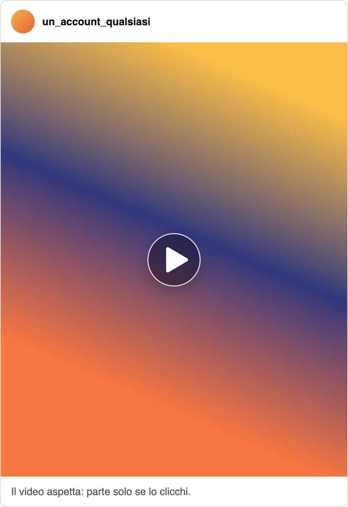
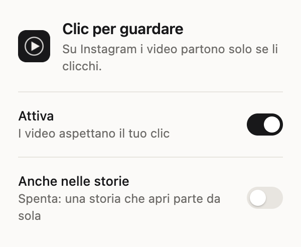

# Clic per guardare

**Su Instagram nessun video parte da solo: parte quando lo clicchi.**

Un'estensione per Chrome. Scorri il feed di Instagram e i video restano fermi, con un bottone al
centro. Se ti interessa lo clicchi e parte, se no tiri dritto.

---

## Perché l'ho fatta

> Scrollando, quando i video partono in automatico, sei portato a guardare anche se sono cose che
> non ti interessano. Per esempio, io non guardo il calcio, non mi piace il calcio, ma spesso il mio
> algoritmo mi bombarda con contenuti calcistici. Capita che, scorrendo, poi mi fermo e guardo
> l'azione, guardo il gol, e invece non vorrei.

Con l'estensione il video del calcio resta fermo, e lo scorro via senza averlo guardato.

---

## Installazione

Non è sul Chrome Web Store: si installa a mano, una volta sola, in un paio di minuti.

1. **Scarica lo zip** — dall'ultima [release](https://github.com/francesac/clic-per-guardare/releases/latest)
   scarica `clic-per-guardare.zip` e fai doppio clic per scompattarlo. Esce una cartella
   `clic-per-guardare`.
2. **Mettila al sicuro** — spostala dove non la cancellerai per sbaglio, per esempio in Documenti.
   Chrome la legge da lì ogni volta: se la butti, l'estensione sparisce.
3. **Apri le estensioni** — nella barra degli indirizzi di Chrome scrivi `chrome://extensions` e
   premi Invio.
4. **Accendi la modalità sviluppatore** — l'interruttore è in alto a destra. Compaiono tre bottoni
   nuovi.
5. **Carica l'estensione** — clicca **«Carica estensione non pacchettizzata»** e scegli la
   cartella `clic-per-guardare` (quella che contiene `manifest.json`).
6. **Fissala nella barra** — clicca l'icona del puzzle in alto a destra e poi la puntina accanto a
   «Clic per guardare». Da lì apri le impostazioni.

Fatto: ricarica Instagram e i video ti aspettano.

Su Brave, Edge, Arc e gli altri browser costruiti su Chrome il percorso è lo stesso (su Edge la
pagina è `edge://extensions`). Non li ho provati.

### Aggiornarla

Scarica lo zip nuovo, sostituisci la vecchia cartella con quella nuova, poi in
`chrome://extensions` premi la freccia circolare sulla scheda dell'estensione.

### Toglierla

In `chrome://extensions` premi **Rimuovi** sulla scheda, poi butta la cartella.

---

## Come si usa

- **Il bottone** — ogni video del feed e dei reel arriva fermo, col bottone al
  centro. Lo clicchi e parte.
- **Un clic sul video** — vale anche cliccare in un punto qualunque del video, compreso il
  bottone dell'audio di Instagram.
- **Il permesso vale per quel video** — se lo fai uscire dallo schermo e poi torni indietro, è di
  nuovo fermo. I video dopo restano fermi anche loro: ognuno vuole il suo clic.

---

## Le due impostazioni

| Interruttore | Di serie | Cosa fa |
|---|---|---|
| **Attiva** | acceso | Spento, Instagram torna a fare come vuole. Comodo se per un po' vuoi i video automatici senza togliere l'estensione. |
| **Anche nelle storie** | spento | Una storia la apri tu, quindi di serie parte da sola. Accendilo se vuoi il bottone anche lì. |

---

## Privacy

- **Nessun dato raccolto** — l'estensione non manda niente a nessuno e non si collega a nessun
  server: nel codice non c'è una sola chiamata di rete.
- **Solo su Instagram** — gira solo sulle pagine di `instagram.com`. Il resto del web non lo vede.
- **Un permesso solo, `storage`** — serve a ricordare i due interruttori. Se hai la
  sincronizzazione di Chrome accesa, ti seguono sugli altri computer, come i segnalibri.

Il codice è tutto qui, in quattro file corti, se vuoi controllare.

---

## Cosa non fa

- **Il telefono** — sull'app di Instagram un'estensione non può entrare. Funziona su Chrome da
  computer, anche con Instagram aperto nel browser.
- **Gli altri social** — funziona solo su Instagram.
- **Instagram che cambia** — Instagram cambia il suo sito spesso. Se un giorno un video riparte da
  solo, apri una [segnalazione](https://github.com/francesac/clic-per-guardare/issues).

---

## Come funziona, per i curiosi

Chrome fa partire un video solo quando la pagina glielo chiede. L'estensione si mette in mezzo a
quella richiesta: se il video non ha il tuo permesso, risponde a Instagram con lo stesso «no» che
dà il browser quando blocca l'autoplay. Instagram lo conosce, tiene l'anteprima e aspetta, senza
credere che il video stia andando.

Il bottone vive dentro il riquadro del video, quindi scorre insieme alla pagina senza codice che
lo rincorra. Se apri una finestra di Instagram sopra il feed, è la finestra a coprirlo.

| File | Cosa fa |
|---|---|
| `estensione/blocco.js` | Ferma i video e disegna il bottone. Gira dentro la pagina, prima di Instagram. |
| `estensione/ponte.js` | Legge le impostazioni salvate e le passa a `blocco.js`. |
| `estensione/popup/` | Il pannello con i due interruttori. |
| `estensione/manifest.json` | Dice a Chrome dove gira l'estensione e cosa può fare. |

---

## Licenza

[MIT](LICENSE): puoi usarla, modificarla e ridistribuirla come vuoi, tenendo il file della licenza.
